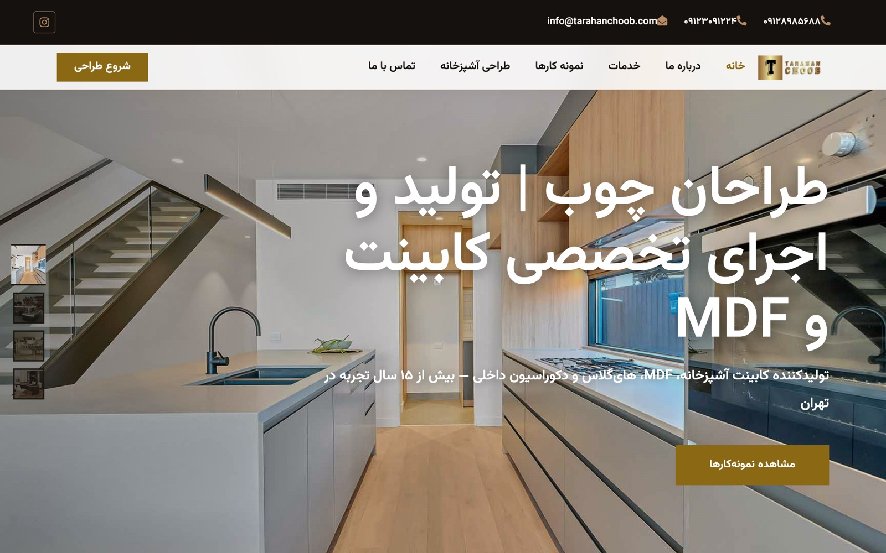

<div align="center">

# 🪵 Woodline (Tarahan Choob) — Cabinet & Interior Design

A bilingual business website for an MDF cabinet and interior design company, with a project gallery and a secure contact form.

<a href="https://woodline-ir.vercel.app/"></a>
<a href="https://github.com/miladmo68/woodline.ir"></a>
<a href="https://miladweb.com"></a>

**🔗 Live:** [woodline-ir.vercel.app](https://woodline-ir.vercel.app/)

</div>

<p align="center">
  
</p>

## ✨ Features

- Persian (RTL) business site with service and gallery sections
- Express server with a Nodemailer contact form
- Security headers, rate limiting and input validation
- Responsive layout for mobile and desktop

## 🛠️ Tech Stack

        

## 🚀 Getting Started

**Prerequisites:** [Node.js](https://nodejs.org/) 18 or newer

**Install and run**

```bash
git clone https://github.com/miladmo68/woodline.ir.git
cd woodline.ir
npm install
npm run dev
```

### Environment variables

Create a `.env` file (or `.env.local` for Next.js) with:

```env
MAIL_FROM=
MAIL_TO=
PORT=
SMTP_HOST=
SMTP_PASS=
SMTP_PORT=
SMTP_SECURE=
SMTP_USER=
TO_EMAIL=
```

## 📁 Project Structure

```
woodline.ir/
├── api/
├── css/
├── img/
├── js/
├── lib/
├── scss/
├── 404.html
├── about.html
├── appointment.html
├── architecture-html-template.jpg
├── contact.html
├── feature.html
├── index.html
└── package.json
```

## 👤 Author

**Milad Mohammadi** — Frontend-Focused Full-Stack Developer, Toronto 🇨🇦

[](https://miladweb.com)
[](https://www.linkedin.com/in/miladmo68/)
[](https://github.com/miladmo68)

<p align="center"><sub>If you like this project, consider giving it a ⭐</sub></p>
